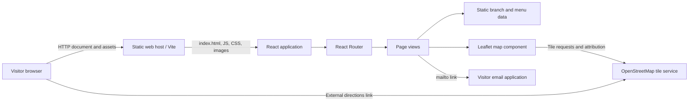
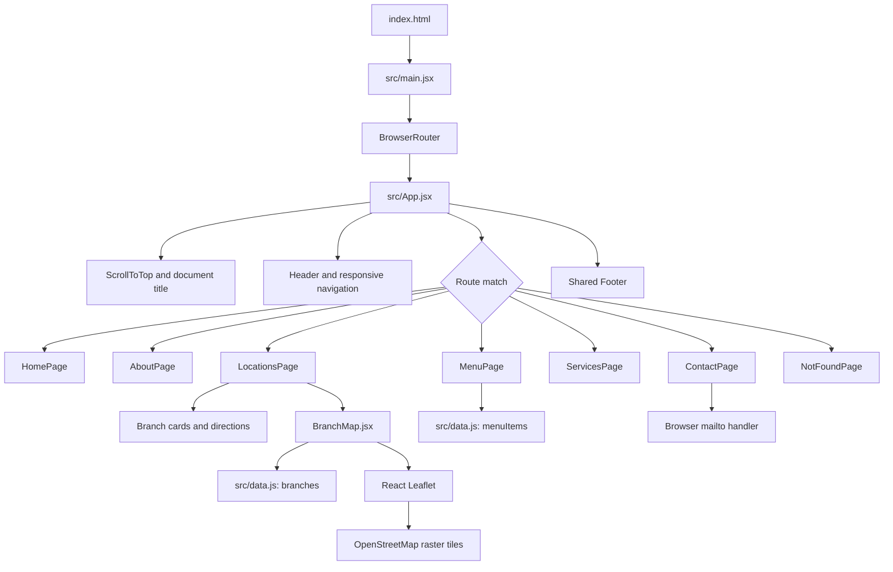
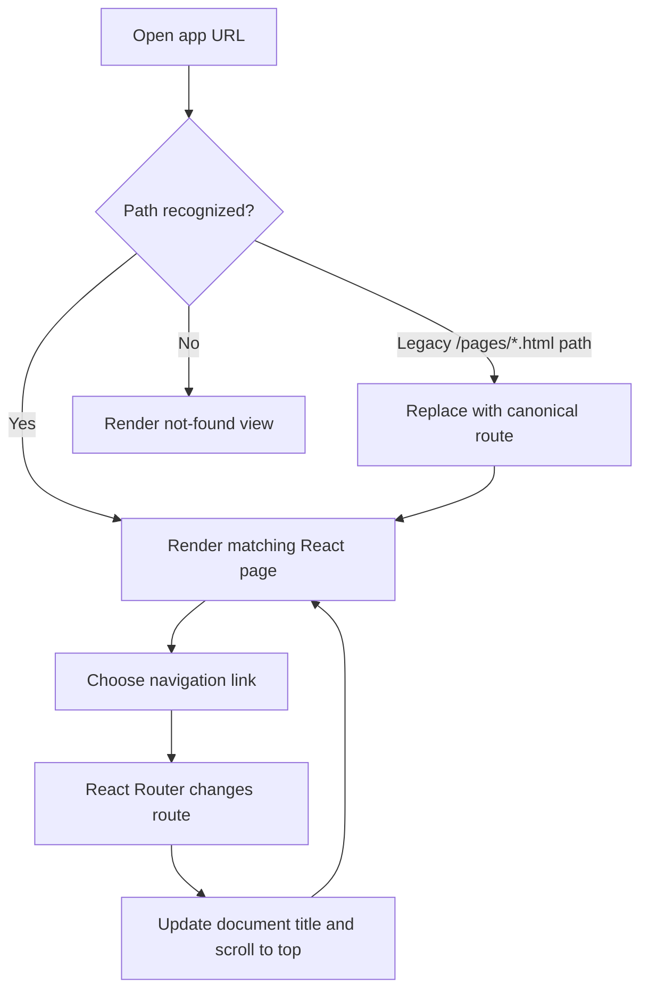
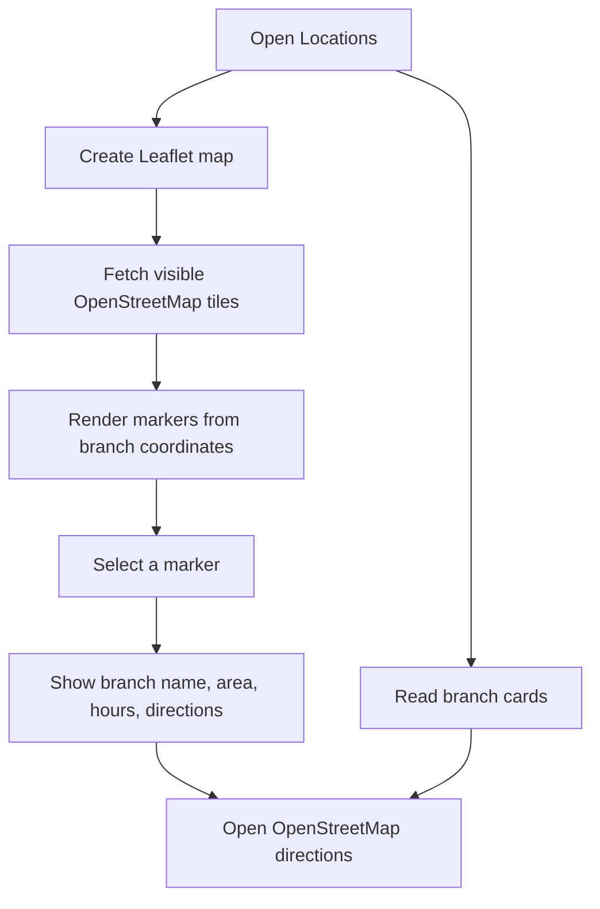
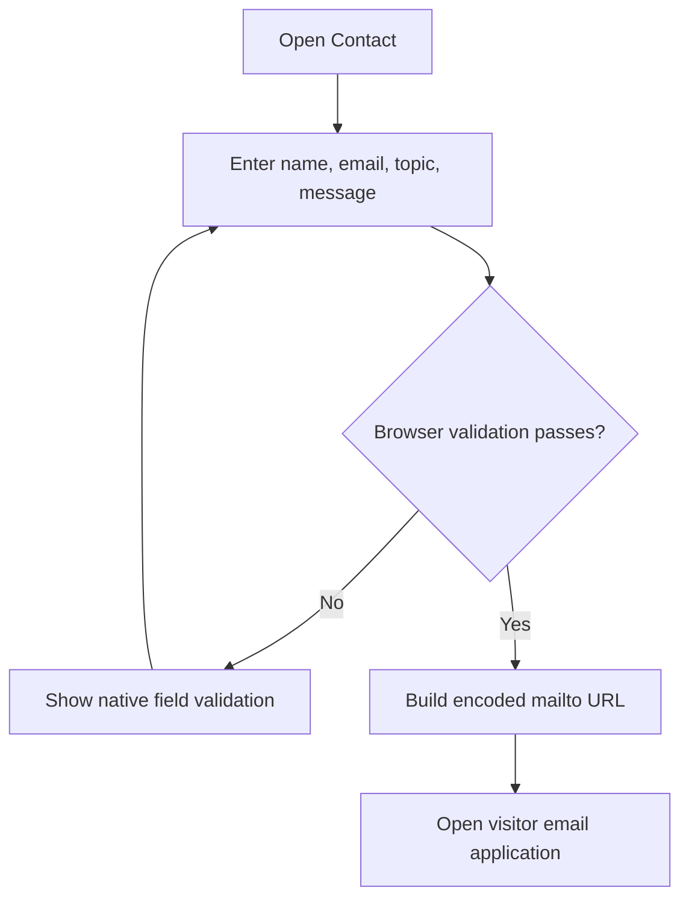

# System Design

## High-Level Design

The site is a static React single-page application. Vite builds the browser bundle; the browser renders route content and requests map tiles directly from OpenStreetMap. There is no application server, database, authentication, or form submission API in this version.

## Low-Level Design

`src/data.js` is the canonical source for branch coordinates and public opening hours. `BranchMap` consumes these records to render map markers and popup directions, while `LocationsPage` uses the same records for readable branch information. The map is initialized to all branch coordinates, disables scroll-wheel zoom by default, and retains Leaflet's native pan/zoom controls and attribution.

## Route and Navigation Flow

## Location and Contact Flows

## Operational Notes

- Use a static host configured to serve `index.html` for unknown paths so direct route loads and legacy aliases reach React Router.
- The OpenStreetMap standard tile endpoint is public infrastructure with a usage policy, not a dedicated application API SLA. For substantial production traffic, use a hosted tile provider and follow its key, attribution, and caching requirements.
- Coordinates originate from the previous location-page map embeds. Verify each pin against the actual storefront before publishing navigation-critical directions.
- The contact flow is client-only and does not deliver messages unless the visitor has a configured email application. Add a backend or managed form provider if guaranteed receipt is required.